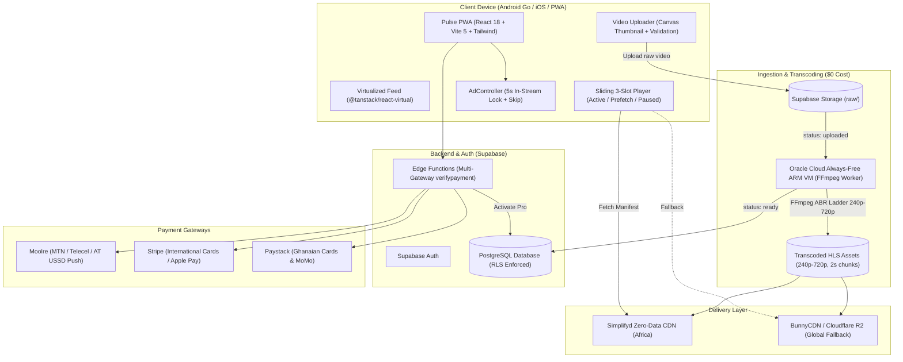

# Pulse — High-Performance Short-Video Platform

> **Platform:** **Pulse**  
> **Target Devices:** Low-end mobile devices (e.g. Samsung Galaxy A12, Android Go, 1GB–2GB RAM) & 2G/3G networks in emerging markets.  
> **Key SLA:** 90+ Lighthouse Performance score, <2s playback startup, zero web fonts, strict 3-slot video virtualization, zero pop-unders.

---

## Quick Start

```bash
npm install
npm run dev        # start local Vite dev server
npm test           # run all 175 unit & integration tests
npm run test:watch # continuous test watcher
npm run typecheck  # strict TypeScript check
npm run build      # production PWA build
```

---

## Platform Architecture



---

## 1. Setting Up the Oracle Cloud Always-Free FFmpeg Worker

Oracle Cloud Infrastructure (OCI) provides an Always-Free Ampere A1 ARM compute tier with **4 OCPUs, 24 GB RAM, and a 100–200 GB NVMe volume at $0/month forever**. This powers our automated multi-bitrate H.264 ladder generation (`240p`, `360p`, `480p`, `720p`) and 2-second HLS segmenting.

### Step 1: Create the ARM VM in Oracle Cloud Console
1. Sign in to [cloud.oracle.com](https://cloud.oracle.com).
2. Navigate to **Compute** → **Instances** → **Create Instance**.
3. Set **Image:** Canonical Ubuntu 22.04 LTS (AArch64).
4. Set **Shape:** `VM.Standard.A1.Flex` (Ampere ARM).
   - OCPUs: **4**
   - Memory: **24 GB**
5. Check **Assign a public IPv4 address** and attach your SSH public key.
6. Set Boot Volume size to **100 GB** and click **Create**.

### Step 2: One-Command Worker Installation
SSH into your VM and run the automated provisioning script:

```bash
ssh -i ~/.ssh/your-key ubuntu@<YOUR_VM_PUBLIC_IP>

# Clone repo and enter worker directory
git clone https://github.com/your-username/pulse.git
cd pulse/worker

# Run automated setup
chmod +x setup-oracle-vm.sh
sudo ./setup-oracle-vm.sh
```

### Step 3: Configure Environment
Copy and fill in `/opt/pulse-worker/.env`:

```ini
SUPABASE_URL=https://your-project.supabase.co
# Must use the SERVICE_ROLE key so the worker can update video status and bypass RLS
SUPABASE_SERVICE_ROLE_KEY=your-supabase-service-role-key
STORAGE_BUCKET_NAME=videos
# Optional: CDN base URL (Simplifyd or BunnyCDN)
CDN_BASE_URL=https://stream.pulse.video
WORKER_ID=oracle-arm-01
POLL_INTERVAL_MS=5000
```

### Step 4: Start the Service
```bash
sudo systemctl start pulse-transcoder
sudo systemctl status pulse-transcoder
# Follow live transcoding logs:
sudo journalctl -u pulse-transcoder -f
```

---

## 2. Configuring Simplifyd (Primary) & BunnyCDN (Fallback)

### Simplifyd Zero-Data CDN (Africa Primary)
1. Partner with Simplifyd to enable zero-rating video data on MTN, Telecel (Vodafone), and AirtelTigo.
2. In the Simplifyd console, configure your origin to pull from your Supabase Storage bucket (`https://<project-ref>.supabase.co/storage/v1/object/public/videos`).
3. Set the custom domain (e.g., `https://zero.pulse.video`).

### BunnyCDN (Global Fallback)
1. In the Bunny.net dashboard, create a **Standard Pull Zone**.
2. **Origin URL:** `https://<project-ref>.supabase.co/storage/v1/object/public/videos`.
3. Enable **Cache Expiration** to 1 year for `.ts` media segments and 1 minute for `.m3u8` playlists.
4. Set custom hostname (e.g., `https://stream.pulse.video`) with free automated SSL.
5. In client code or worker config, set `CDN_BASE_URL` to point to BunnyCDN or Simplifyd.

---

## 3. Deploying Frontend to Cloudflare Pages

Pulse is an ultra-lightweight Vite Single-Page Application (PWA) that deploys for free on Cloudflare Pages.

1. Push your repository to GitHub or GitLab.
2. Log in to the [Cloudflare Dashboard](https://dash.cloudflare.com) and go to **Workers & Pages** → **Create Application** → **Pages**.
3. Connect your repository and configure build settings:
   - **Framework preset:** `Vite`
   - **Build command:** `npm run build`
   - **Build output directory:** `dist`
4. Set Environment Variables:
   - `VITE_SUPABASE_URL`: `https://your-project.supabase.co`
   - `VITE_SUPABASE_ANON_KEY`: `your-anon-key`
   - `VITE_PAYSTACK_PUBLIC_KEY`: `pk_test_...`
   - `VITE_STRIPE_PUBLISHABLE_KEY`: `pk_test_...`
   - `VITE_EXOCLICK_ZONE_ID`: `your-zone-id`
5. Click **Save and Deploy**.
6. Under **Custom Domains**, connect your live domain (e.g. `pulse.video`) with automatic Cloudflare SSL and edge caching.

---

## 4. Multi-Gateway Payment Configuration

Pulse provides a unified, provider-agnostic payment abstraction with server-side validation.

### African Mobile Money (Moolre)
- Direct USSD push prompt on user phones for MTN, Telecel, and AirtelTigo.
- Add secrets to Supabase Edge Functions:
  ```bash
  supabase secrets set MOOLRE_API_KEY=your_moolre_api_key
  supabase secrets set MOOLRE_ACCOUNT_NUMBER=your_account_number
  ```

### Global Cards & Apple Pay (Stripe)
- Global international card processing at $0.99 / month (GHS 10.00 equivalent).
- Add Stripe secrets to Supabase Edge Functions:
  ```bash
  supabase secrets set STRIPE_SECRET_KEY=sk_test_...
  ```
- Add publishable key to frontend environment:
  `VITE_STRIPE_PUBLISHABLE_KEY=pk_test_...`

### Ghanaian Mobile Money & Cards (Paystack)
- Add Paystack secret key to Supabase Edge Functions:
  ```bash
  supabase secrets set PAYSTACK_SECRET_KEY=sk_test_...
  ```

### Server Verification Flow
All payments are verified server-side through `supabase/functions/verifypayment/index.ts`. The client physically cannot self-grant Pro; only verified transactions written via `service_role` activate active subscription status.

---

## 5. Non-Negotiable Performance Constraints

- **DOM Virtualization:** Only 3 video elements are kept in DOM memory at once ($i-1$ paused, $i$ active, $i+1$ preloaded 240p HLS manifest/chunk). All others are completely detached to guarantee stability on 1GB RAM devices.
- **System Fonts Only:** `font-family: system-ui, -apple-system, sans-serif` — zero web font downloads.
- **Ad Experience:** In-stream only with 5-second unskippable countdown lock (`AdController.tsx`). Zero pop-unders or unprompted tab spawns.
- **Transcoding:** Offloaded completely to Oracle Cloud ARM VM; client and frontend server do zero heavy encoding.

---

## Documentation Index

| File | Purpose |
|---|---|
| [`docs/ARCHITECTURE.md`](docs/ARCHITECTURE.md) | In-depth architectural blueprint, component graph, and data flow |
| [`docs/DATABASE.md`](docs/DATABASE.md) | Table schemas, migration records, and RLS security model |
| [`docs/DEPLOYMENT.md`](docs/DEPLOYMENT.md) | Production launch checklist and credential directory |
| [`worker/README.md`](worker/README.md) | Dedicated Oracle Cloud VM FFmpeg worker runbook |
| [`docs/TESTING.md`](docs/TESTING.md) | Test suite breakdown (175 passing tests) |
| [`docs/USER_FLOWS.md`](docs/USER_FLOWS.md) | Detailed user flow state machines |
| [`PRODUCTION_TODO.md`](PRODUCTION_TODO.md) | Launch tracking and credential checklist |
