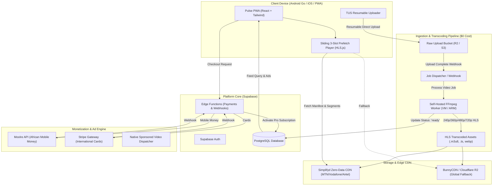

# Pulse: High-Performance Media Streaming Platform
## Architecture Decision Record & Implementation Roadmap

> **Platform Brand:** **Pulse** (powered by the *FlowState Global* design system)  
> **Target Devices:** Low-end mobile devices (e.g. Samsung Galaxy A12, Android Go, 1GB–2GB RAM) & 2G/3G networks worldwide, scaling from Ghana to global markets.

---

## 1. Executive Summary & Design Alignments

| Domain | Decision | Rationale |
|---|---|---|
| **Brand Identity** | **Pulse** | Globally neutral, energetic, short, universally pronounceable, no geographic lock-in. |
| **Design System** | **FlowState Global** | Pure Black (`#000000`), Surface (`#121212`), Primary Accent (`#00E676`), Secondary Pink (`#FF4081`), system fonts only, 48px touch targets, WCAG 2.1 AA. |
| **Video Codec & Ladder** | **Multi-tier H.264 ABR** (240p, 360p, 480p, 720p) | 100% hardware-accelerated decoding across all low-end Android/iOS chips; zero frame drops; ultra-low bitrates (250–500 kbps base) for 2G/3G networks. |
| **Ingestion Protocol** | **TUS Resumable Direct Upload** | Prevents upload aborts on spotty mobile networks; chunks uploaded directly to object storage without server bottlenecks. |
| **Transcoding Worker** | **Self-Hosted FFmpeg Worker** (Free/low-cost VM / Oracle Cloud Always-Free ARM) | Zero SaaS encoding fees ($0); zero CPU/battery load on creators' mobile phones; automated HLS segmenting + WebP poster generation. |
| **Client Playback Engine** | **Sliding 3-Slot Prefetch Window** | Prev: paused frame; Active: playing; Next: preloaded first 2s at lowest bitrate. All other slots completely detached to prevent memory leaks on 1GB RAM devices. |
| **Payment Engine** | **Unified Provider-Agnostic Gateway** (Moolre + Stripe) | Supabase Edge Function routing African Mobile Money (MTN, Telecel/Vodafone, AirtelTigo) through Moolre, and international cards through Stripe. |
| **Ad Experience** | **Native In-Feed Sponsored Video Reels** | UX-first: looks and swipes like a real video card with a neutral `#9E9E9E` "Sponsored" tag and "Learn More" CTA. Zero pop-unders, zero redirects. |

---

## 2. High-Performance Architecture Diagram

---

## 3. Four-Phase Implementation Roadmap

### Phase 1: Rebranding & Client Performance Leap (Immediate Focus)
- [ ] **Design Tokens Migration**: Update `tailwind.config.js` and `src/index.css` to **FlowState Global** specifications:
  - Background: `#000000`, Surface: `#121212`, Primary Accent: `#00E676`, Secondary Accent: `#FF4081`, Ad Badge: `#9E9E9E`, Ad Surface: `#181818`.
  - System font stack (zero web font download overhead).
  - Minimum touch target: 48px.
- [ ] **Brand Update**: Rename "GhanaReels" to **Pulse** across UI, headers, metadata, PWA manifests, and legal footers.
- [ ] **Sliding 3-Slot Playback Engine**:
  - Refactor `VideoPlayer.tsx` and `VideoFeed.tsx` with a smart slot controller:
    - Slot `i`: Active playback.
    - Slot `i + 1`: Preload poster + first 2-second lowest-bitrate HLS segment.
    - Slot `i - 1`: Paused on current frame.
    - All other indices: Detached from DOM / media buffers cleared for strict low-RAM stability.

### Phase 2: Ingestion & Transcoding Pipeline ($0 Infrastructure)
- [ ] **Database Schema Update**: Add processing state tracking to `videos`:
  - `status`: `'uploading' | 'processing' | 'ready' | 'failed'`.
  - `hls_master_url`, `resolutions`, `aspect_ratio`.
- [ ] **TUS Resumable Direct Upload**: Update `UploadScreen.tsx` with resumable chunked upload support.
- [ ] **FFmpeg Transcoding Pipeline**:
  - Script multi-bitrate H.264 ladder generation:
    - 240p (250 kbps), 360p (450 kbps), 480p (800 kbps), 720p (1200 kbps).
    - Segment length: 2s (ideal for fast mobile startup and instant scrubbing).
    - High-quality WebP animated/static poster extraction.

### Phase 3: Unified Payment Engine (Moolre + Stripe)
- [ ] **Edge Function Router**: Refactor `verifypayment` to abstract payment providers.
- [ ] **Moolre Integration**: Add Mobile Money checkout & webhook handlers for MTN, Telecel, and AirtelTigo.
- [ ] **Stripe Gateway**: Add international card support.
- [ ] **Client UI**: Update `ProUpgradeModal.tsx` to allow seamless Mobile Money or Card payment.

### Phase 4: Native In-Feed Sponsored Ads
- [ ] **Native Sponsored Card Component**: Replace old placeholder banner ad references with a dedicated native video ad reel.
- [ ] Clean `#9E9E9E` "Sponsored" pill, advertiser avatar, title, and "Learn More" external/in-app link.
- [ ] Ad insertion controller respecting user tiers (Anonymous: every 5 videos; Free: every 10 videos; Pro: zero ads).
