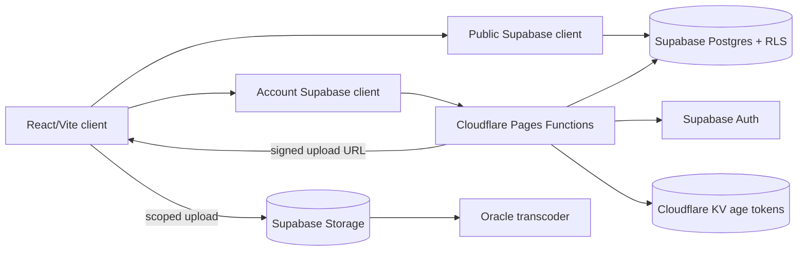

# Trust-First, Privacy-First Implementation Plan

Date: 2026-10-28  
Source audit: `security_privacy_audit.md`  
Scope: Authentication, age verification, user state, anonymous storage, account synchronization, and engagement state.  
Non-goal: Rebuild or redesign the feed, playback, transcoding, upload validation, or core database model.

## Outcome

The app will retain its existing React/Vite experience and Supabase/Oracle pipeline, but durable trust decisions will move to a first-party Cloudflare Pages Function layer.

- Public feed/search remain direct-to-Supabase with the anonymous key for low latency and bandwidth.
- Supabase access and refresh tokens never enter JavaScript or Web Storage.
- Authenticated database traffic passes through a same-origin proxy that reads `HttpOnly` cookies and continues to rely on Supabase RLS.
- Browser uploads use short-lived, object-scoped signed upload URLs; validation, progress reporting, database insertion, and Oracle transcoding semantics remain unchanged.
- Anonymous saves and progress use a single validated `localStorage` record with per-item 24-hour expiry.
- Ephemeral UI state uses `sessionStorage`.
- Age verification collects only a boolean declaration and sets the exact `age_verified` `HttpOnly` cookie.
- Age-restricted records stay deny-by-default until their media is stored privately and delivered with short-lived signed URLs.
- Continuous engagement timers are removed. Daily activity is event-based and foreground-only.

## Architecture decision

### Why a first-party server seam is required

Browser JavaScript cannot create or read `HttpOnly` cookies. A normal Supabase browser client also needs a bearer token for authenticated PostgREST, RPC, and Storage calls. Therefore, simply changing `persistSession` is insufficient.

The implementation will use two Supabase clients:

1. **Public client** — direct Supabase origin, anonymous key, auth persistence disabled. Used only for public feed, public search, public profiles, and other explicitly public reads.
2. **Account client** — same Supabase query interface, but its base URL points to `/api/supabase`. The Pages Function proxy reads auth cookies, refreshes them server-side, attaches the user JWT to the fixed Supabase origin, and lets existing RLS enforce authorization.

The account client will be created with the Supabase `accessToken` callback returning `null`. In the installed Supabase version, using this option disables the client auth namespace. This makes accidental future `supabase.auth.*` use fail immediately rather than reintroducing browser session storage.



## Deep modules and seams

Each module exposes a small interface and hides storage, cookie, refresh, expiry, validation, and retry rules inside its implementation.

### 1. Session module

Proposed interface:

```ts
interface SessionModule {
  bootstrap(): Promise<SessionSnapshot>;
  signIn(email: string, password: string): Promise<AuthResult>;
  signUp(email: string, password: string): Promise<AuthResult>;
  signOut(): Promise<void>;
  getSnapshot(): SessionSnapshot;
  subscribe(listener: () => void): () => void;
}
```

The client interface returns user/tier/loading/error state only. It never returns tokens.

Production adapter: same-origin Pages Function fetches.  
Test adapter: in-memory session adapter.

### 2. Anonymous-state module

Proposed interface:

```ts
interface AnonymousStateModule {
  snapshot(): AnonymousSnapshot;
  toggleSaved(videoId: string): SaveResult;
  recordProgress(videoId: string, positionSeconds: number, completed: boolean): void;
  clearHistory(): void;
  buildSyncPayload(): AnonymousSyncPayload;
  acknowledgeSync(result: AnonymousSyncResult): void;
}
```

The interface hides TTL envelopes, pruning, caps, schema validation, legacy cleanup, and storage failures.

Production adapter: browser `localStorage`.  
Test adapter: in-memory `Storage` plus fake clock.

### 3. Age-verification module

Proposed client interface:

```ts
interface AgeVerificationModule {
  status(): Promise<'verified' | 'unverified'>;
  declareAdult(): Promise<'verified'>;
}
```

The client cannot read or manufacture the verification token.

Production server adapter: Cloudflare KV with native 30-day TTL.  
Test adapter: in-memory token store with fake clock.

### 4. Account-sync module

Proposed interface:

```ts
interface AccountSyncModule {
  syncAfterAuthentication(): Promise<SyncSummary>;
}
```

It owns idempotency, conflict resolution, retry, partial acknowledgement, and local cleanup.

### 5. UI-session module

Proposed interface:

```ts
interface UiSessionModule {
  load(): UiSessionState;
  update(patch: Partial<UiSessionState>): void;
  clear(): void;
}
```

It stores only non-sensitive tab-lifetime state. Passwords, payment fields, auth tokens, age state, and personal form contents are prohibited.

## Phase 0 — Baseline and change guardrails

### Work

1. Preserve the existing audit report and add this plan to version control.
2. Record current passing results for `npm test`, `npm run typecheck`, and `npm run build`.
3. Add characterization tests around:
   - public feed pagination;
   - shared video loading;
   - video upload validation and progress callbacks;
   - authenticated saves, likes, comments, follows, profile editing, settings export/deletion, and payments;
   - existing Oracle worker queue and storage outputs.
4. Add feature flags for staged rollout:
   - server: `TRUST_AUTH_V2`;
   - client: `VITE_TRUST_AUTH_V2` only as a public rollout selector, never as a secret.

### Exit criteria

- Baseline behavior is captured before transport/storage changes.
- A failed trust-layer rollout can disable authenticated actions without falling back to Web Storage tokens.

## Phase 1 — First-party cookie session layer

### New server files

- `functions/_lib/cookies.ts`
- `functions/_lib/csrf.ts`
- `functions/_lib/supabaseAuth.ts`
- `functions/_lib/session.ts`
- `functions/_lib/http.ts`
- `functions/api/auth/sign-in.ts`
- `functions/api/auth/sign-up.ts`
- `functions/api/auth/session.ts`
- `functions/api/auth/sign-out.ts`
- `functions/api/auth/adopt.ts` — temporary migration endpoint
- `functions/api/supabase/[[path]].ts`

### Cookie policy

| Cookie | Purpose | Attributes |
|---|---|---|
| `__Host-pulse_access` | Short-lived Supabase access JWT | `HttpOnly; Secure; SameSite=Strict; Path=/`; expiry matches Supabase token |
| `__Host-pulse_refresh` | Supabase refresh token | `HttpOnly; Secure; SameSite=Strict; Path=/; Max-Age=2592000` |
| `__Host-pulse_csrf` | Double-submit CSRF value | `Secure; SameSite=Strict; Path=/`; deliberately not `HttpOnly` |

Production always uses `Secure`. Localhost development may disable `Secure` through server-only environment detection; this override must never be enabled on a deployed hostname.

### Authentication behavior

1. Sign-in/sign-up endpoints accept credentials over same-origin HTTPS and forward them to Supabase Auth.
2. Passwords and returned tokens are never logged, included in analytics, or returned to client JavaScript.
3. Cookies are set only after Supabase confirms the session.
4. `/api/auth/session` returns sanitized user information and tier only.
5. The server refreshes expired access cookies with the refresh cookie and rotates both cookies.
6. Sign-out revokes the Supabase refresh token when possible, then expires every auth cookie.
7. All auth/session responses use `Cache-Control: no-store`.

### Authenticated Supabase proxy

`/api/supabase/[[path]]` will:

- allow only the fixed configured Supabase origin;
- accept only `rest/v1` and the small Storage operations required by account features;
- reject `auth/v1`, admin routes, arbitrary URLs, and service-role operations;
- strip client `Authorization`, `apikey`, `cookie`, and forwarding headers before upstream requests;
- attach the anonymous key plus the validated user access JWT from the cookie;
- preserve Supabase RLS as the authorization control;
- validate CSRF and Origin on `POST`, `PUT`, `PATCH`, and `DELETE`;
- return `Cache-Control: no-store` for user-specific responses;
- refresh cookies on the response if the access token was renewed.

### Client changes

Add:

- `src/services/session.ts`
- `src/services/publicSupabase.ts`
- `src/services/accountSupabase.ts`
- `src/context/SessionProvider.tsx`

Modify:

- `src/hooks/useAuth.ts` to consume the Session module;
- every current `supabase.auth.getUser/getSession/onAuthStateChange` caller to use the session snapshot or current-user hook;
- `src/services/supabase.ts` to be removed or retained only as a temporary compatibility export with no auth namespace.

Public-read modules such as `useVideos`, search, and public profile discovery will use `publicSupabase`. Authenticated hooks and screens will use `accountSupabase`.

### Existing-session migration

To avoid unexpectedly signing out existing users:

1. For one transition release, read only the exact legacy Supabase auth key derived from the configured project reference.
2. Send the existing token pair once to `/api/auth/adopt` over same-origin HTTPS.
3. The server validates it with Supabase, sets cookies, and returns no token material.
4. The client deletes the legacy key only after adoption succeeds.
5. Remove `/api/auth/adopt` and its client migration code after the migration window.

Do not scan or transmit unrelated `localStorage` keys.

### Exit criteria

- No Supabase access/refresh token exists in `localStorage`, `sessionStorage`, React state, module variables, or network responses readable by JavaScript.
- `document.cookie` cannot see access/refresh cookies.
- All current account features continue to pass RLS using the proxy.
- Requests without a valid session receive `401`.
- State-changing requests without valid CSRF and Origin checks receive `403`.

## Phase 2 — Upload and payment authorization migration

### Uploads

The current file validation, thumbnail extraction, progress interface, row insertion, and Oracle queue remain intact.

Add:

- `functions/api/uploads/sign.ts`

Change `src/services/videoUpload.ts` only at the transport seam:

1. Request an object-scoped signed upload URL after server-side session and ban checks.
2. Upload the file directly to Supabase Storage with the signed token.
3. Keep the existing `UploadProgress` interface and UI callbacks.
4. Return the same `{url, path}` shape to `UploadScreen`.
5. Insert the video row through `accountSupabase`, preserving the current moderation/transcoding state machine.

The signing endpoint validates MIME type, extension, maximum size, allowed prefix, uploader identity, and path uniqueness. Its service-role key is never available to the generic proxy or browser.

### Payments

Add a same-origin payment route that:

- authenticates through the session cookies;
- validates CSRF/Origin;
- forwards to the existing `verifypayment` Edge Function with a server-held user JWT;
- returns only payment status/checkout URL fields.

Update `moolre.ts`, `payments.ts`, `paystack.ts`, and `stripe.ts` to stop calling `supabase.auth.getSession` or constructing bearer headers.

### Exit criteria

- Upload and payment browser requests contain no user bearer token.
- Upload progress and Oracle transcoding behavior remain unchanged.
- Signed upload URLs cannot write outside the issued user/path and expire quickly.

## Phase 3 — Privacy-first age verification

### New files and infrastructure

- `src/components/AgeGateModal.tsx`
- `src/services/ageVerification.ts`
- `functions/_lib/ageVerification.ts`
- `functions/api/age/status.ts`
- `functions/api/age/verify.ts`
- Cloudflare KV binding: `AGE_VERIFICATIONS`

### Declaration flow

1. The modal contains one affirmative action: `I am 18+` and a cancel/back action.
2. The request body contains only `{ declaredOver18: true }`.
3. The server generates 32 cryptographically random bytes and stores the opaque token in KV with a 30-day TTL.
4. The server sets the exact cookie name required by the specification:

```text
age_verified=<opaque token>; HttpOnly; Secure; SameSite=Strict; Path=/; Max-Age=2592000
```

5. `/api/age/status` checks the cookie against KV and returns only verified/unverified.
6. No name, birthdate, weekday, email, ID, IP-derived profile, or document is stored as age-verification evidence.

### Restricted-content enforcement

Do not relax the existing RLS deny behavior merely because the modal exists.

Before age-restricted playback is enabled:

1. Create a private Supabase Storage bucket for restricted raw and transcoded assets.
2. Store canonical object paths in existing URL text fields for restricted records; do not persist expiring signed URLs.
3. Add a dedicated server route for restricted metadata and short-lived playback/poster URLs.
4. Validate `age_verified` before every restricted metadata or URL issuance request.
5. Keep restricted videos out of public feed/search queries and public CDN paths.
6. Update the Oracle worker to select `visibility`, choose the private destination for `age_restricted`, and return object paths instead of public URLs.
7. Quarantine or migrate any existing age-restricted objects before enabling access.

If Simplifyd/Bunny cannot enforce signed access, age-restricted assets must bypass those public CDN paths. Public content continues using the current CDN pipeline.

### Terms update

Clarify the distinction:

- platform account minimum age remains whatever legal/product policy approves;
- access to content labeled `18+ Only` requires the separate self-declaration gate.

### Exit criteria

- No restricted row or media object is obtainable through public feed/search or a public bucket URL.
- Missing, forged, revoked, or expired age cookies receive `403`.
- Valid verification expires automatically after 30 days.
- No PII is collected or stored by the age flow.

## Phase 4 — TTL-limited anonymous data and session UI state

### New files

- `src/lib/anonymousState.ts`
- `src/lib/ttlStorage.ts`
- `src/lib/uiSessionState.ts`
- tests using an injected clock and in-memory Storage adapter

### Anonymous storage format

Use one versioned key: `pulse:anonymous:v1`.

Each save/progress entry contains:

- video ID;
- minimal state such as position/completed;
- `updatedAt`;
- `expiresAt` no later than 24 hours after the last permitted write.

Limits:

- maximum five saved video IDs;
- maximum 50 progress/history entries;
- bounded serialized size;
- schema validation and numeric clamping on every read;
- prune expired/corrupt entries on read, write, app bootstrap, and sign-out/account deletion.

Do not store video descriptions, creator profiles, emails, search text, auth state, or age state in this record.

### UI session storage

Use `sessionStorage` for:

- active view/tab;
- search filters/query if product wants same-tab restoration;
- active feed item index rather than continuous pixel scroll position;
- modal/conversion reason;
- pending non-sensitive action ID.

Never store passwords, phone numbers, card/payment input, support-message drafts, tokens, or age status.

### Wiring changes

- `VideoCard.handleSaveVideo` uses local saves for anonymous users.
- `useSavedVideos` merges local anonymous IDs with public video lookup.
- `useVideoProgress` uses the anonymous-state module instead of raw per-video keys.
- `useWatchHistory` returns local TTL history for anonymous users.
- `settings.ts` uses 24-hour TTL storage for anonymous playback preferences and server-authoritative values for signed-in privacy consent.
- Remove `pulse:resume-position:*`, `pulse_anonymous_viewing`, and legacy settings after privacy-safe migration. Untimestamped legacy guest history should be discarded rather than granted a fresh retention period.

### Exit criteria

- Anonymous saves/history survive reloads but not beyond 24 hours.
- Expired data is removed automatically without a background timer.
- Shared-device account deletion/sign-out removes local user-scoped state.
- Existing feed and playback behavior remains unchanged when storage is unavailable or corrupted.

## Phase 5 — Anonymous-to-account synchronization and conversion triggers

### New files

- `src/services/accountSync.ts`
- `src/components/TrustConversionModal.tsx`
- `functions/api/sync/anonymous.ts`

### Sync behavior

1. Trigger only after the Session module confirms a real authenticated session.
2. Submit a bounded, schema-validated payload through the cookie-authenticated endpoint.
3. Upsert saves using the existing `saved_videos` composite key.
4. Merge watch progress with the existing `video_watch_progress` table/RPC:
   - completed state is monotonic;
   - newer server state wins over older local state;
   - otherwise the newer local position is stored.
5. Return per-item acknowledgement.
6. Delete only acknowledged local items.
7. Retry safely after offline/network failure; repeated sync calls remain idempotent.
8. Run sync after sign-in, confirmed sign-up, and authenticated app bootstrap when local state remains.

No database schema change is required for saves or progress.

### Conversion behavior

- Saves 1–5 remain local and silent.
- Save 6 opens: `Sign up to save your content permanently and continue on other devices.`
- An attempted use of expired content may open the same modal, but expiration itself is not monitored in the background.
- The auth modal receives an `AuthIntent` such as `save-limit`, `ttl-expired`, or `upload`.
- After authentication and sync, the client resumes the pending save/action exactly once.

### Exit criteria

- Local state merges without duplicates or data loss.
- Local data remains until the server acknowledges it.
- The first anonymous save never forces signup.
- Conversion copy accurately describes retention and device-sync effects.

## Phase 6 — Replace continuous engagement tracking

### Work

1. Remove `ViewingBudgetTracker`, its one-second `localStorage` writes, the five-second App refresh timer, and the 60-minute hard wall.
2. Add a small `DailyActivity` module that marks activity only when foreground playback begins or a meaningful feed interaction occurs.
3. Guard the event with `document.visibilityState === 'visible'`.
4. Write at most once per local calendar day; no interval, heartbeat, or elapsed-minute counter.
5. For anonymous users, keep the marker within the same 24-hour anonymous-state envelope.
6. For signed-in users, use the sanitized `last_sign_in_at` returned by the Session module when the product needs login-day presentation.

No separate streak implementation or database fields currently exist. This plan will not invent permanent cross-device engagement surveillance. If product later requires a multi-day server streak, that needs a separately approved minimal schema and retention decision.

### Exit criteria

- No engagement `setInterval` remains in App/client tracking code.
- Background tabs do not record activity.
- Anonymous users retain full viewing utility.

## Phase 7 — Security and privacy hardening

### Work

1. Add edge response headers:
   - CSP without `unsafe-eval` and with the narrowest practical script/connect sources;
   - `X-Content-Type-Options: nosniff`;
   - `Referrer-Policy`;
   - `frame-ancestors`/clickjacking protection;
   - appropriate `Permissions-Policy`.
2. Exclude `/api/**`, auth, age, and user responses from service-worker/runtime caching.
3. Pin or self-host the Paystack script if supported; otherwise constrain it with CSP and documented change control.
4. Ensure logs redact cookies, authorization values, passwords, payment phone numbers, and request bodies containing credentials.
5. Add rate limits/backoff to sign-in, signup, age-token issuance, upload signing, and sync endpoints.
6. Update privacy/terms copy to reflect actual retention and anonymous behavior.

## Test plan

### Unit tests

- TTL boundary at 23:59:59 and 24:00:00.
- Corrupt, oversized, wrong-version, and tampered local storage.
- Five-save cap and sixth-save conversion result.
- Progress merge ordering and completed-state monotonicity.
- Daily activity produces one write per day and none while hidden.
- Cookie serialization includes every production flag.
- CSRF comparison and strict Origin enforcement.
- Age-token generation, KV lookup, expiry, and revocation.
- Session refresh rotation and cookie clearing.

### Integration tests

- Sign-in → cookies set → session endpoint returns user → no token in response/storage.
- Legacy session adoption → cookies set → legacy key removed.
- Authenticated proxy preserves RLS and rejects missing/invalid sessions.
- Anonymous feed/search work without cookies.
- Signed upload URL succeeds for the issued path and fails for another path/expired token.
- Anonymous save/progress → signup → sync → local clear → server state visible.
- Age-restricted request is denied without verification and allowed with a valid token.
- Restricted media URL expires and is not a public Storage/CDN URL.
- Sign-out/account deletion clears cookies and local user state.

### Regression suite

- `npm test`
- `npm run typecheck`
- `npm run build`
- worker tests/build
- manual low-end/mobile checks for feed startup, upload progress, offline retry, and data-saver behavior

## Rollout plan

1. Deploy server endpoints and cookie/session tests while the old client remains active.
2. Enable session adoption for internal/test accounts.
3. Switch authenticated client traffic to the proxy; keep public feed direct.
4. Migrate uploads/payments and verify Oracle processing.
5. Remove browser token persistence and monitor authentication failures.
6. Release anonymous TTL storage and sync.
7. Release the age modal while keeping restricted content deny-all.
8. Enable restricted content only after private storage and signed delivery pass verification.
9. Remove temporary legacy adoption code and obsolete storage keys.

Rollback must never restore Web Storage tokens. If the new session layer fails, authenticated mutations should be temporarily disabled while anonymous viewing remains available.

## Expected schema and infrastructure impact

### No database schema change required

- authentication cookie layer;
- authenticated Supabase proxy;
- anonymous saves/history TTL;
- saves/watch-progress synchronization;
- conversion triggers;
- daily-active timer removal.

### Infrastructure changes required

- Cloudflare Pages Function secrets for Supabase URL/keys and cookie configuration;
- Cloudflare KV binding for opaque age tokens;
- private Supabase Storage bucket for age-restricted assets;
- Oracle worker configuration for public versus restricted destination storage.

### Schema change deliberately deferred

Permanent cross-device streak history is excluded because no streak schema currently exists and adding behavioral tracking is not necessary to secure the architecture.

## Final compliance checklist

- [ ] No auth/session/refresh token in `localStorage` or `sessionStorage`.
- [ ] Auth cookies are `HttpOnly`, production `Secure`, and `SameSite=Strict`.
- [ ] Cookie-authenticated mutations enforce CSRF and Origin checks.
- [ ] `age_verified` is opaque, `HttpOnly`, `Secure`, `SameSite=Strict`, and expires in 30 days.
- [ ] Age verification collects no PII.
- [ ] Restricted metadata and media are inaccessible without server validation.
- [ ] Anonymous saves and history expire within 24 hours.
- [ ] Anonymous save count is capped at five before contextual conversion.
- [ ] Account sync is idempotent and clears only acknowledged local data.
- [ ] Ephemeral UI state uses `sessionStorage`.
- [ ] Continuous engagement/background timers are removed.
- [ ] Public feed, playback, uploads, moderation flow, and Oracle transcoding remain functionally intact.
