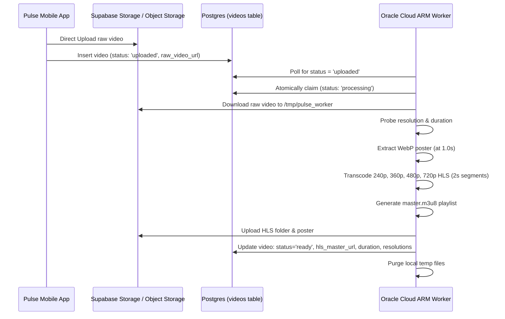

# Pulse ABR HLS Video Transcoder Worker

> **Platform:** Pulse High-Performance Streaming Platform  
> **Deployment Target:** Oracle Cloud Always-Free Ampere A1 ARM VM (4 OCPUs, 24GB RAM, $0/month)  
> **Transcode Pipeline:** H.264 Multi-Bitrate Ladder (240p, 360p, 480p, 720p) + 2s HLS Chunks + WebP Poster  

---

## 1. Oracle Cloud Always-Free VM Specifications

Oracle Cloud Infrastructure (OCI) provides an Always-Free tier that is ideal for self-hosted video transcoding:

| Resource | Specification | Cost |
|---|---|---|
| **Shape** | `VM.Standard.A1.Flex` (Ampere Altra ARM64) | **$0 / month** |
| **Compute** | **4 OCPUs** (4 vCPUs dedicated hardware threads) | **$0 / month** |
| **Memory** | **24 GB RAM** (Ample for multi-stream parallel encoding) | **$0 / month** |
| **Boot Volume** | 50 GB – 200 GB NVMe | **$0 / month** |
| **Outbound Data** | 10 TB / month free | **$0 / month** |
| **Operating System** | Ubuntu 22.04 LTS Minimal (aarch64) | **$0 / month** |

---

## 2. One-Time VM Provisioning in Oracle Cloud Console

1. **Sign in** to your Oracle Cloud account: [cloud.oracle.com](https://cloud.oracle.com).
2. Go to **Compute** → **Instances** → **Create Instance**.
3. Configure the instance:
   - **Name:** `pulse-transcoder-01`
   - **Placement:** Any availability domain (e.g., AD-1).
   - **Image:** Canonical Ubuntu 22.04 LTS.
   - **Shape:** Change shape → **Ampere** (ARM) → `VM.Standard.A1.Flex`.
     - Set **OCPUs:** 4.
     - Set **Memory:** 24 GB.
   - **Networking:** Select or create a Virtual Cloud Network (VCN) with a Public Subnet. Ensure **Assign a public IPv4 address** is checked.
   - **SSH Keys:** Download or paste your public SSH key.
   - **Boot Volume:** Set to 100 GB (free tier covers up to 200 GB total across tenancy).
4. Click **Create** and wait 60 seconds for status to change to **Running**.
5. Note the **Public IP Address** (e.g. `129.150.x.x`).

---

## 3. Worker Installation & Setup

SSH into your new Oracle Cloud instance:

```bash
ssh -i ~/.ssh/your-key ubuntu@<YOUR_VM_PUBLIC_IP>
```

Clone your repository (or copy the `worker/` directory):

```bash
git clone https://github.com/your-username/pulse.git
cd pulse/worker
```

Run the automated provisioning script:

```bash
chmod +x setup-oracle-vm.sh
sudo ./setup-oracle-vm.sh
```

The script will automatically:
1. Update system packages.
2. Install FFmpeg with H.264 (`libx264`) and WebP (`libwebp`) support.
3. Install Node.js 20 LTS (ARM64).
4. Create the service user `pulse` and paths `/opt/pulse-worker` and `/tmp/pulse_worker`.
5. Compile TypeScript sources.
6. Register the systemd unit `pulse-transcoder.service`.

---

## 4. Configuration

Edit `/opt/pulse-worker/.env`:

```bash
sudo nano /opt/pulse-worker/.env
```

Set the required environment variables:

```ini
# Supabase credentials (MUST use the SERVICE_ROLE key so the worker can bypass RLS and update videos)
SUPABASE_URL=https://your-project.supabase.co
SUPABASE_SERVICE_ROLE_KEY=eyJhbGciOi...

# Supabase Storage bucket for videos
STORAGE_BUCKET_NAME=videos

# Optional: CDN delivery domain (Simplifyd or BunnyCDN)
# CDN_BASE_URL=https://stream.pulse.video

# Worker configuration
WORKER_ID=oracle-arm-01
POLL_INTERVAL_MS=5000
CONCURRENCY=1

# System paths
FFMPEG_PATH=/usr/bin/ffmpeg
FFPROBE_PATH=/usr/bin/ffprobe
TEMP_DIR=/tmp/pulse_worker
```

Save with `Ctrl + O` and exit with `Ctrl + X`.

---

## 5. Starting & Monitoring the Service

Start the service and check its status:

```bash
# Start service
sudo systemctl start pulse-transcoder

# Check status
sudo systemctl status pulse-transcoder

# Follow live transcoding logs
sudo journalctl -u pulse-transcoder -f
```

---

## 6. How the Transcoding Pipeline Works



### Generated ABR Stream Ladder

| Resolution | Aspect | Video Bitrate | Audio Bitrate | Keyframe (GOP) | Target Network |
|---|---|---|---|---|---|
| **240p** | 240x426 (9:16) | 250 kbps | 64 kbps (AAC) | 60 frames (2s) | 2G / EDGE / GPRS |
| **360p** | 360x640 (9:16) | 450 kbps | 64 kbps (AAC) | 60 frames (2s) | Spotty 3G |
| **480p** | 480x854 (9:16) | 800 kbps | 96 kbps (AAC) | 60 frames (2s) | Standard 3G / 4G |
| **720p** | 720x1280 (9:16) | 1200 kbps | 128 kbps (AAC) | 60 frames (2s) | 4G / Wi-Fi / Pro |
